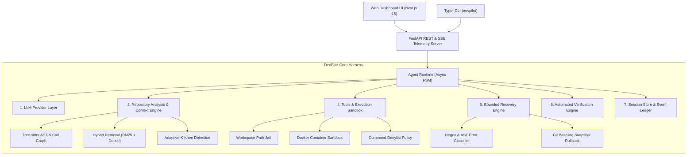

# DevPilot: Autonomous Coding Agent Harness

[](https://github.com/DurgaPavan0923/DevPilot_MLPWP/actions/workflows/ci.yml)
[](https://www.python.org/)
[](https://nextjs.org/)
[](LICENSE)
[](https://github.com/astral-sh/ruff)
[](https://mypy-lang.org/)
[](https://pytest-cov.readthedocs.io/)

DevPilot is a modular coding agent harness positioned between foundation Large Language Models (LLMs) and software repositories. It does not train models. Instead, it investigates whether repository-aware adaptive context retrieval and structured execution feedback with bounded error recovery improve the reliability, precision, and efficiency of coding agents on real-world repositories.

---

## Academic Project and Submission Details

This software and research evaluation framework was designed and developed as a final-year B.Tech capstone project.

- **Course:** CSE4192, Machine Learning Projects with Python
- **Faculty Supervisor:** Jagseer Singh

### Project Team

| Student Name | Registration Number | Role in Project |
| :--- | :--- | :--- |
| **Ayusman Das** | 2341004073 | Agent Runtime, FSM Control Loop, and Tool Execution |
| **Selina Mohanty** | 2341013299 | Evaluation Harness, SWE-bench Runner, and Statistics |
| **Rajana Durga Pavan Kumar** | 2341011099 | LLM Provider Layer, Token Ledger, and Security Sandbox |
| **Akanshaa Mohanta** | 2341013229 | Context Engine, AST Indexer, and Web Dashboard UI |

---

## Research Question and Hypothesis

Autonomous coding agents frequently encounter two critical failure modes on non-trivial software repositories:
1. **Context Distraction and Budget Exhaustion:** Providing unranked or excessive repository files causes model attention degradation, hallucinations, and rapid token expenditure.
2. **Infinite Error Loops:** Unhandled runtime exceptions, broken tool inputs, and failing test commands trigger repetitive, unrecoverable agent cycles.

**Central Research Question:**
> *Do adaptive context retrieval (combining AST dependency graphs, BM25 lexical search, dense semantic embeddings, and dynamic knee detection) and structured execution feedback with bounded rollback recovery improve the reliability of coding agents on real repositories?*

### Project Status: Results Pending Real Model Evaluation

All architectural subsystems, test suites, sandboxing controls, and evaluation harnesses are fully implemented, strictly typed, and verified with automated test coverage. Experimental benchmark numbers against frontier models (such as DeepSeek-Coder, Claude 3.5 Sonnet, and GPT-4o) are pending complete multi-seed evaluation runs across SWE-bench task distributions. Results should be generated using the evaluation pipeline documented below.

---

## Architectural Blueprint

DevPilot adheres to an interface-driven architecture where each of the seven core subsystems can be independently configured, benchmarked, or swapped:



---

## The 7 Core Components

### 1. LLM Provider Layer (`devpilot/llm/`)
- Unified asynchronous interface (`LLMProvider`) supporting Anthropic, OpenAI, Google Gemini, DeepSeek, Ollama, and OpenAI-compatible endpoints.
- Streaming responses with real-time token tracking via `tiktoken` and provider metadata.
- Cost accounting ledger enforcing per-step and per-session financial ceilings.
- Structured tool-calling abstraction with automatic JSON and XML schema fallback for models lacking native function calling.
- Exponential backoff with jitter for transient HTTP 429 and 503 errors.

### 2. Repository Analysis and Context Engine (`devpilot/repo/`)
- Tree-sitter AST symbol extractor parsing Python, TypeScript, and JavaScript functions, classes, methods, and call sites.
- NetworkX directed dependency graph calculating PageRank importance and 1-hop topological neighbor expansion.
- Reciprocal Rank Fusion (RRF) combining sparse BM25 scores with dense vector similarities from `sentence-transformers` and FAISS.
- Adaptive-K context budgeting using Kneedle curvature analysis on the RRF curve to eliminate prompt bloat.

### 3. Agent Runtime and Control Loop (`devpilot/agent/`)
- Deterministic asynchronous finite-state machine with explicit states: `ANALYZE`, `PLAN`, `ACT`, `OBSERVE`, `RECOVER`, `VERIFY`, `DONE`, and `FAILED`.
- ReAct reasoning traces interleaved with structured tool actions and environment observations.
- Human-in-the-loop approval gating for interactive and auto-safe security modes.
- Real-time event streaming dispatching typed events over Server-Sent Events (SSE).

### 4. Structured Tools and Execution Sandbox (`devpilot/tools/`)
- Core tool primitives: `read_file`, `create_file`, `edit_file` (with line preservation and exact matching), `list_dir`, `run_command`, `git_diff`, and `revert_workspace`.
- Docker container sandbox with non-root UID execution, dropped Linux capabilities, and 2GB RAM limits.
- Workspace path jail resolving canonical paths and rejecting directory traversal, backslash evasion, and symlink breakout attempts.
- Command denylist blocking dangerous operations, raw device writes, and unquoted shell chaining.

### 5. Feedback-Driven Bounded Recovery (`devpilot/agent/recovery.py`)
- Automated error classifier matching regex patterns and AST exception frames across four classes: `SYNTAX_ERROR`, `RUNTIME_EXCEPTION`, `TEST_FAILURE`, and `PERMISSION_DENIED`.
- Taxonomical recovery prompts advising the agent on corrective repairs based on the specific error class.
- Strict recovery attempt budget (default: maximum 3 recovery steps per sub-task).
- Clean git snapshot rollback to the last verified baseline state when recovery budget is exhausted.

### 6. Automated Verification Engine (`devpilot/agent/verification.py`)
- Baseline pre-patch verification recording initial failing tests on the target issue.
- Post-patch verification executing tests inside isolated sandbox environments to confirm issue resolution without regressions.
- AST syntax validation ensuring code edits do not introduce invalid syntax or missing symbols.
- Clean unified git diff generation ready for review or benchmark submission.

### 7. Session Store and REST API (`devpilot/session/`, `devpilot/api/`)
- Persistent SQLite session store recording every thought, tool invocation, diff, token tally, and financial cost.
- FastAPI backend serving session lifecycle, repository inspection, and evaluation management endpoints.
- Streaming SSE endpoint (`/api/sessions/{id}/events`) for live dashboard telemetry.
- Human approval endpoint (`/api/sessions/{id}/approval`) for interactive permission elevation.

---

## Quickstart Guide

### 1. Prerequisites
- Python 3.11 or 3.12
- Node.js 20+ and pnpm (for web dashboard)
- Git
- Docker (optional, for isolated sandbox execution)

### 2. Installation
```bash
# Clone the repository
git clone https://github.com/DurgaPavan0923/DevPilot_MLPWP.git
cd DevPilot_MLPWP

# Create virtual environment
python -m venv .venv

# Activate environment (Linux / macOS)
source .venv/bin/activate
# Or on Windows PowerShell:
# .venv\Scripts\Activate.ps1

# Install core harness and development dependencies
pip install -e ".[dev,full]"

# Install frontend dependencies
cd web && pnpm install && cd ..
```

### 3. Environment Configuration
Copy the template configuration file:
```bash
cp .env.example .env
```
Populate your API keys in `.env`:
```env
OPENAI_API_KEY="sk-..."
ANTHROPIC_API_KEY="sk-ant-..."
DEEPSEEK_API_KEY="sk-..."
GEMINI_API_KEY="AIza..."
DEVPILOT_API_TOKEN="optional-secret-bearer-token"
```

### 4. Running a Task via CLI
```bash
# Run task using default DeepSeek Coder model
python -m devpilot.cli run --task "Fix ZeroDivisionError in billing calculator" --repo .

# Run task with mock provider for verification (no API key required)
python -m devpilot.cli run --task "Fix syntax error in calculator" --provider mock --model mock-model
```

### 5. Running the API and Web Dashboard
```bash
# Terminal 1: Launch FastAPI backend (http://localhost:8000)
python -m devpilot.cli serve --host 127.0.0.1 --port 8000

# Terminal 2: Launch Next.js web application (http://localhost:3000)
cd web && pnpm dev
```

---

## CLI Command Reference

The CLI is implemented using Typer and accessible via `devpilot` or `python -m devpilot.cli`:

| Command | Arguments | Options | Description |
| :--- | :--- | :--- | :--- |
| `devpilot run` | `--task, -t TEXT` | `--repo PATH`, `--preset TEXT`, `--provider TEXT`, `--model TEXT`, `--mode TEXT`, `--max-steps INT` | Executes an autonomous coding task on the specified repository. |
| `devpilot serve` | None | `--host TEXT` (default 0.0.0.0), `--port INT` (default 8000), `--reload` | Starts the FastAPI server and SSE telemetry stream. |
| `devpilot eval run` | None | `--suite PATH`, `--preset TEXT`, `--seeds TEXT`, `--concurrency INT`, `--results-dir PATH` | Executes comparative benchmark suite across presets. |
| `devpilot index build` | None | `--repo PATH` (default .), `--output PATH` | Builds AST symbol index and directed call graph. |

---

## REST API Endpoints

The FastAPI server exposes endpoints secured with optional Bearer token authentication:

| Method | Endpoint | Description |
| :--- | :--- | :--- |
| `GET` | `/api/health` | Health check returning version, uptime, and registered LLM providers. |
| `GET` | `/api/sessions` | List all persisted agent sessions with token and cost summaries. |
| `POST` | `/api/sessions` | Initialize and launch a new autonomous coding agent session. |
| `GET` | `/api/sessions/{id}` | Retrieve session details, execution state, and message history. |
| `GET` | `/api/sessions/{id}/diff` | Return the unified git diff generated by the session. |
| `GET` | `/api/sessions/{id}/events` | Server-Sent Events (SSE) stream dispatching real-time trace events. |
| `POST` | `/api/sessions/{id}/approval` | Submit human-in-the-loop decision (approve or reject) for gated commands. |
| `GET` | `/api/repo/tree` | List repository file tree filtered by `.gitignore` patterns. |
| `GET` | `/api/repo/file` | Read safe workspace file content guarded by workspace jail. |
| `GET` | `/api/repo/index` | Return AST symbol count and repository statistics. |
| `GET` | `/api/repo/graph` | Return directed dependency call graph nodes and edges. |
| `POST` | `/api/eval/runs` | Launch an asynchronous background evaluation run. |
| `GET` | `/api/eval/runs` | List all evaluation runs and their current statuses. |
| `GET` | `/api/eval/latest` | Fetch the latest evaluation report summary and McNemar test values. |

---

## Configuration Variables

| Variable | Required | Default | Purpose |
| :--- | :--- | :--- | :--- |
| `OPENAI_API_KEY` | Optional | None | API key for OpenAI foundation models. |
| `ANTHROPIC_API_KEY` | Optional | None | API key for Anthropic Claude models. |
| `DEEPSEEK_API_KEY` | Optional | None | API key for DeepSeek models. |
| `GEMINI_API_KEY` | Optional | None | API key for Google Gemini models. |
| `OLLAMA_BASE_URL` | Optional | `http://localhost:11434` | Base endpoint for local Ollama instances. |
| `DEVPILOT_API_TOKEN` | Optional | None | Secret bearer token guarding REST API routes. |
| `DEVPILOT_WORKSPACE` | Optional | `.` | Root directory path for agent tool operations. |
| `DEVPILOT_DATABASE_URL`| Optional | `sqlite:///sessions.db` | SQLAlchemy connection URL for persistent storage. |

---

## Safety and Sandboxing Model

DevPilot implements multi-layered defensive controls to guarantee safe agent operation:

1. **Workspace Path Jail (`PathSandbox`):**
   Every file access resolves canonical real paths and validates that paths reside strictly within the allowed workspace boundary. Parent traversals (`..`), platform-dependent path evasions, and external symlink links are blocked with a `SafetyError`.
2. **Docker Container Sandbox:**
   When running with container isolation, shell commands execute inside a restricted Docker micro-environment with non-root UID execution, 2GB memory ceilings, CPU quotas, and drop-all Linux capabilities.
3. **Command Policy Denylist:**
   Dangerous shell operations, fork bombs, recursive file deletions outside the repository, and direct disk block access are blocked before process invocation.
4. **Permission Modes:**
   - `read_only`: Only permits analysis, search, and reading.
   - `auto_safe`: Allows file edits and reading, but requires interactive human approval before executing shell commands.
   - `interactive`: Prompts for approval before every modifying action.
   - `autonomous`: Unrestricted execution within the container sandbox.

---

## Evaluation and Reproduction Runbook

### Experimental Configurations
The evaluation framework assesses three agent presets:
1. `basic`: Vanilla ReAct without context retrieval or graph expansion.
2. `fixed_rag`: Fixed Top-K (K=5) BM25 and dense semantic retrieval.
3. `full`: Full DevPilot with hybrid RRF retrieval, AST graph expansion, adaptive knee detection, and bounded recovery.

### Running the Evaluation Pipeline

```bash
# Verify harness mechanics with deterministic mock provider (zero cost)
python scripts/reproduce.py --allow-mock --concurrency 4

# Run live evaluation with DeepSeek Coder across 3 random seeds
python scripts/reproduce.py --provider deepseek --model deepseek-coder --seeds 42,137,2026 --concurrency 4

# Run live evaluation with Claude 3.5 Sonnet
python scripts/reproduce.py --provider anthropic --model claude-3-5-sonnet-20241022 --seeds 42,137,2026
```

### Generated Research Artifacts
All benchmark runs automatically output verified artifacts into standard directories:
- `results/latest_evaluation_report.json`: Machine-readable trial records, token counts, and hypothesis test metrics.
- `results/ieee_results_table.tex`: Ready-to-paste camera-ready LaTeX table for manuscripts.
- `results/results_summary.csv`: Tabular CSV output for data science analysis.
- `output_images/resolve_rate_comparison.svg`: Vector graphic chart comparing resolve rates.
- `output_images/precision_recall_tradeoff.svg`: Pareto curve illustrating adaptive retrieval precision versus recall.

---

## Repository Monorepo Layout

```
DevPilot_MLPWP/
├── devpilot/                 # Core Python agent harness package
│   ├── agent/                # FSM state machine, planning loop, recovery, verification
│   ├── api/                  # FastAPI REST endpoints, auth, and SSE telemetry
│   ├── llm/                  # Unified provider adapters, token ledger, pricing tables
│   ├── repo/                 # AST scanner, tree-sitter symbol parser, call graphs
│   ├── tools/                # Guarded tools: file edit, read, command runner, diff
│   └── safety/               # Path jail, Docker container sandbox, command denylist
├── web/                      # Next.js 15 web dashboard application
│   ├── app/                  # App Router pages: home, product, docs, eval, sessions
│   ├── components/           # Sockets, Monaco diff editor, AST graph, FSM stepper
│   ├── lib/                  # Strongly typed API client and offline mock fixtures
│   └── public/               # Favicon set, icon.svg, robots.txt, sitemap.xml
├── eval/                     # Evaluation framework and benchmarking harness
│   ├── dataset.py            # Task suite loader for built-in tasks and SWE-bench Lite
│   ├── runner.py             # Parallel experiment runner with caching and timeouts
│   ├── metrics.py            # Resolve rates, precision@K, recall@K, token aggregations
│   ├── statistics.py         # Paired McNemar test, Holm-Bonferroni, 10k bootstrap CI
│   └── export.py             # LaTeX table and CSV exporters
├── results/                  # Generated benchmark reports, LaTeX tables, CSV summaries
├── output_images/            # Generated publication SVG charts and figures
├── notebooks/                # Jupyter analysis notebooks (01_results_analysis.ipynb)
├── docker/                   # Dockerfile configurations for API, Web, and Sandbox
├── tests/                    # Pytest test suite with >=80% coverage enforcement
├── scripts/                  # Reproduction, smoke testing, and launch check scripts
├── Makefile                  # Monorepo build and development automation targets
└── pyproject.toml            # Python packaging and dependency declarations
```

---

## Make Targets

```bash
make install       # Install Python package in editable mode with development dependencies
make test          # Run pytest with >=80% coverage gate enforcement
make lint          # Run ruff check on backend and pnpm lint on frontend
make format        # Format Python code with ruff format
make typecheck     # Run mypy --strict on devpilot and eval, plus pnpm typecheck on web
make check-all     # Run lint, typecheck, tests, and pre-flight validation
make run           # Launch autonomous task via CLI
make serve         # Launch FastAPI server on port 8000
make web-dev       # Start Next.js frontend in development mode
make web-build     # Build Next.js production bundle
make eval          # Run evaluation suite across all 3 presets
make docker-build  # Build Docker images for API, Web, and Sandbox
make launch-check  # Execute launch readiness script
```

---

## Vercel Deployment Guide

To deploy the DevPilot web dashboard on Vercel:

1. Connect the GitHub repository `DurgaPavan0923/DevPilot_MLPWP` to your Vercel team.
2. In the Project Settings:
   - **Root Directory:** Set to `web`
   - **Framework Preset:** Select `Next.js`
   - **Build Command:** `pnpm build`
   - **Install Command:** `pnpm install`
   - **Output Directory:** Automatically detected as `.next`
3. Configure Environment Variables in Vercel:
   - `NEXT_PUBLIC_API_URL`: URL of your deployed DevPilot FastAPI backend (or leave unset for mock mode).
   - `NEXT_PUBLIC_MOCK_API`: Set to `true` to enable self-contained offline demonstration mode.
   - `NEXT_PUBLIC_CONTACT_EMAIL`: Contact email address displayed on privacy and terms pages.
4. Deploy the project. The build compiles all 11 static routes without requiring a backend connection during deployment.

---

## References

1. **ReAct:** Yao, S., Zhao, J., Yu, D., et al. (2022). *ReAct: Synergizing Reasoning and Acting in Language Models.* ICLR 2023.
2. **RepoCoder:** Zhang, J., Chen, X., Shen, J., et al. (2023). *RepoCoder: Repository-Level Code Completion Through Iterative Retrieval and Generation.* EMNLP 2023.
3. **SWE-bench:** Jimenez, C. E., Yang, J., Wettig, A., et al. (2024). *SWE-bench: Can Language Models Resolve Real-World GitHub Issues?* ICLR 2024.
4. **SWE-agent:** Yang, J., Jimenez, C. E., Wettig, A., et al. (2024). *SWE-agent: Agent-Computer Interfaces Enable Automated Software Engineering.* NeurIPS 2024.
5. **Agentless:** Xia, C. S., Deng, Y., & Zhang, L. (2024). *Agentless: Demystifying LLM-based Software Engineering Agents.* arXiv:2407.01489.

---

## License

This project is licensed under the Apache License 2.0. See the [LICENSE](LICENSE) file for details.
