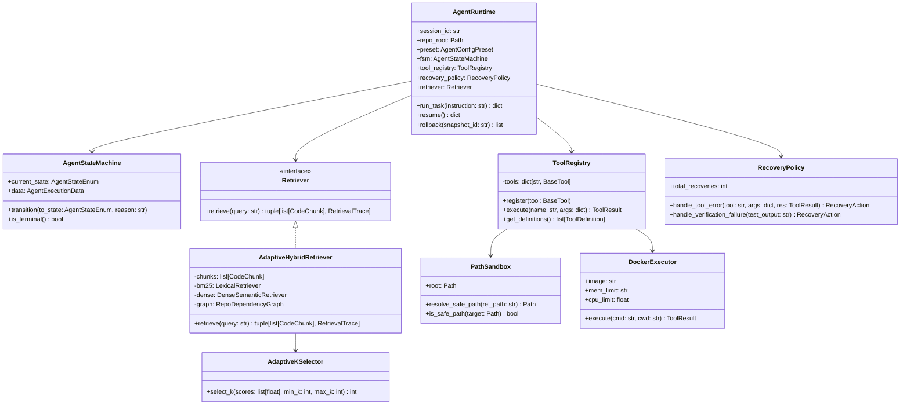
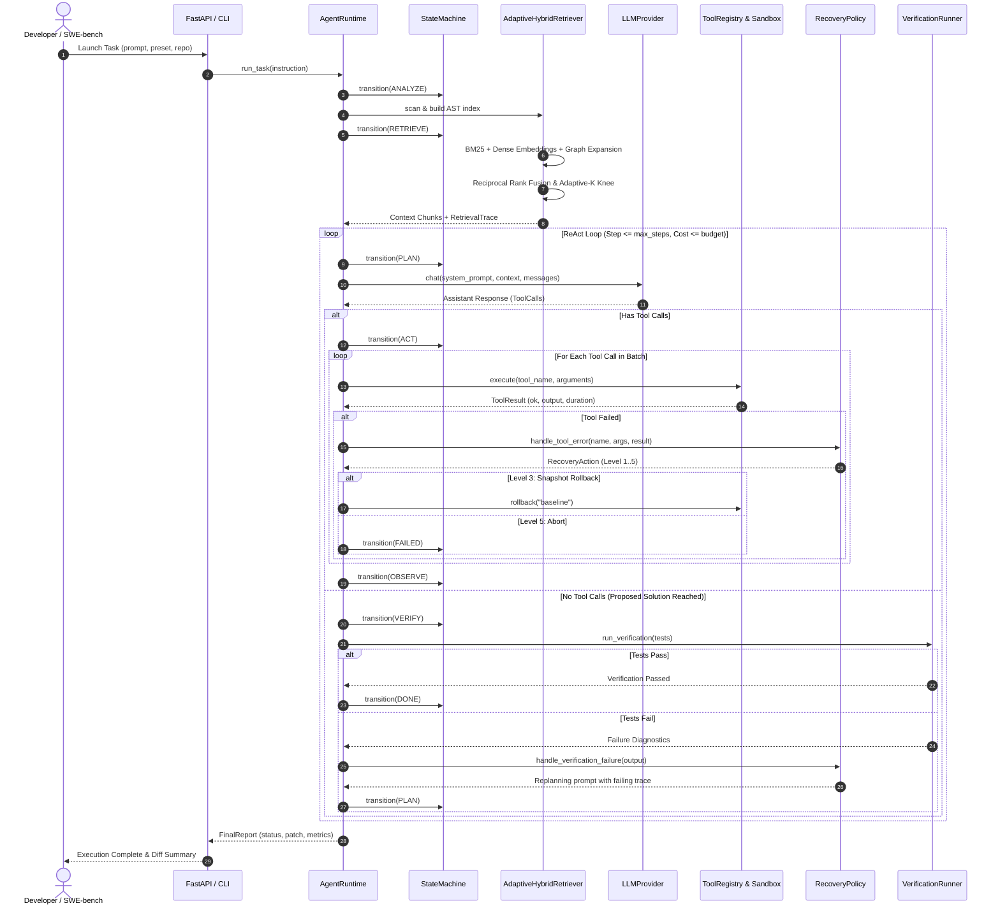

# DevPilot System Architecture & Technical Specification

## 1. Architectural Philosophy & Research Objectives

DevPilot is a modular, repository-aware autonomous coding agent harness designed for rigorous empirical research on software repair reliability. Rather than training proprietary foundation models, DevPilot acts as an intermediate cognitive and operational harness between existing state-of-the-art LLMs (OpenAI GPT-4o, Anthropic Claude 3.5 Sonnet, DeepSeek Coder, Google Gemini, local Ollama) and real-world codebases.

The core research objective of DevPilot is evaluating:
1. **Adaptive-K Context Retrieval:** Whether dynamic knee-detection over multi-modal reciprocal-rank fused scores reduces prompt token bloat while boosting recall of bug-inducing files compared to fixed Top-K RAG.
2. **Structured Bounded Recovery:** Whether a 5-tier deterministic escalation ladder with checkpoint rollbacks mitigates autoregressive compounding errors and tool hallucination loops.
3. **Defense-in-Depth Sandboxing:** Whether layered containment (canonical path jail, AST command policy, Docker microVMs) allows safe autonomous execution of untrusted agent-generated code.

---

## 2. Component Class Diagram

---

## 3. End-to-End Execution Sequence

---

## 4. Subsystem Specifications

### 4.1 LLM Provider Layer
- **Async Streaming Base (`LLMProvider`):** Abstract base class defining `chat()`, `chat_stream()`, `count_tokens()`, and `calculate_cost()`.
- **Supported Adapters:** Anthropic Claude (native tool calling with input schemas), OpenAI (function calling API), Google Gemini (Content parts and function declarations), DeepSeek (native chat format with caching tokens), Ollama (local open-weights models like Qwen2.5-Coder and Llama-3.1), and deterministic `MockProvider`.
- **JSON/XML Tool Calling Fallback:** Robust parser handling models lacking native tool APIs by extracting `<tool_call>` tags or markdown JSON codeblocks.
- **Resilience Engine:** Exponential backoff with jitter on HTTP 429/500/503 errors and sliding-window token bucket rate limiters.

### 4.2 Adaptive Context Engine
- **AST Parsing (`RepoIndex`):** Tree-sitter parsers for Python, JavaScript, TypeScript, and Java extracting function, class, and method symbols with line ranges.
- **Call & Dependency Graph (`RepoDependencyGraph`):** Directed network tracking file imports and class relationships with PageRank centrality and BFS neighbor expansion.
- **Fusion Calibration:** Dual min-max calibration normalizing BM25 lexical BM25 scores and cosine embeddings before applying weighted Reciprocal Rank Fusion ($k=60$):
  $$RRF\_Score(d) = \sum_{m \in \{lex, dense, graph\}} \frac{w_m}{k + r_m(d)}$$
- **Kneedle Knee Detection (`AdaptiveKSelector`):** Automatically computes the maximum difference between normalized cumulative score and diagonal line on the sorted RRF distribution curve, selecting the mathematical elbow point to prevent context pollution.

### 4.3 Tool Execution & Safety Architecture
- **Normalized Envelope (`ToolResult`):** Every tool execution returns a typed envelope with boolean success, string output, error classification, duration in milliseconds, process exit code, and truncation flag.
- **Canonical Workspace Jail (`PathSandbox`):** Enforces path resolution within repository boundaries, explicitly preventing NUL bytes, Windows double-backslash traversal (`..\\..\\`), and symbolic link escapes.
- **Command Whitelist (`CommandSecurityPolicy`):** Enforces tokenized command checking, blocking shell operators (`|`, `&`, `;`, `` ` ``, `$()`), path evasion tricks (`/bin/rm`), and dangerous system utilities.
- **Container Isolation (`DockerExecutor`):** Sandboxed container runner with read-only root filesystems, explicit memory (4GB) and CPU (2.0 cores) quotas, and no network egress (`network_mode="none"`).

### 4.4 Bounded Recovery Engine
- **Error Classifier:** Categorizes runtime exceptions into deterministic classes: `SYNTAX_ERROR`, `FILE_NOT_FOUND`, `PATCH_MISMATCH`, `PERMISSION_DENIED`, `TEST_FAILURE`, and `TIMEOUT`.
- **5-Tier Escalation Ladder:**
  - **Level 1 (Self-Correction):** Structured retry with targeted diagnostic error hints.
  - **Level 2 (Re-Retrieval):** Dynamic contextual re-indexing using failing symbols or stack traces.
  - **Level 3 (Approach Switch / Rollback):** Reverts dirty filesystem changes back to the pre-turn baseline snapshot.
  - **Level 4 (Alternative Tooling):** Switches tool modality (e.g. falling back from exact patch edit to file rewrite).
  - **Level 5 (Bounded Abort):** Safely terminates execution when retry caps or cost budgets are exceeded, preventing runaway API bills.
